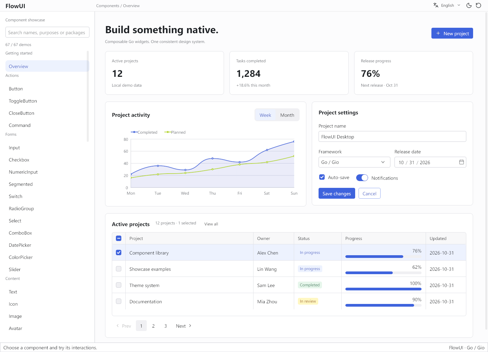

# FlowUI 组件展示

参考 `go-gui/examples/showcase` 的分类浏览方式，用 FlowUI 自身组件搭建的交互目录。包含 67 个演示页面，覆盖当前全部公开 `widget` 子包，并补充综合工作台、布局与动画示例。

在仓库根目录运行：

```sh
go run ./examples/showcase
```



## 使用

- 默认使用英文。右上角语言菜单显示当前语言，展开后可明确选择 `简体中文` 或 `English`，勾号标记当前选项；左侧导航只显示当前语言。
- 默认打开“概览”综合工作台，展示统计卡片、周/月图表、项目设置、日期选择、复选框、开关、带多选与进度条的分页表格。支持新建项目、保存与恢复设置、排序和跨页保留选择；窄窗下纵向排列。
- 切换会更新分类、说明、演示文案、代码示例和按钮文档，同时同步日期、菜单等组件的内置语言。当前页面、主题、搜索词和已输入的演示数据会保留；“重置演示”保留当前语言。
- 左侧按操作、表单、内容、数据与导航、菜单与浮层、反馈、图表、应用布局分类。
- 搜索框支持中文、英文组件名、用途和包名；点击结果进入演示。
- 每页提供可操作的组件、基本用法、导入路径和完整示例文件位置。代码可以选中复制，片段中的 `m`、数据和回调需由应用提供。
- Button 页在演示下方显示 [Markdown 文档](docs/button.md)：基本用法、构造参数、常见用法、方法与默认值、变体与尺寸、点击事件、键盘操作和按钮组。宽窗显示参数表，窄窗改为逐项展示。
- 顶部全局工具栏采用约 36dp 的紧凑高度，统一提供语言、主题和重置操作。月亮图标切换深色，太阳图标切换浅色，旁边的重置图标恢复全部演示数据；悬停图标可查看操作说明。
- Button 页默认不播放加载动画；开启“演示按钮加载动画”后查看旋转指示器，关闭后恢复静止，避免首页持续重绘。
- 窗口宽度小于 820dp 时，点击左上角目录图标浏览或搜索，再选择组件或点击返回图标返回演示；顶部语言、主题和重置操作始终可用。
- 表单、选择和图表使用本地演示数据；操作反馈显示在底部状态栏。消息支持自动消失、关闭和撤销，工作台支持切换、关闭和重新打开文档。
- 数字输入支持范围、步进、精度和草稿提交；分段选择、面包屑、骨架屏和命令面板均提供可操作的页面。
- Input 展示五种外观和三种尺寸；Checkbox 展示全选联动、部分选中、只读和必填校验；Switch、ToggleButton 展示尺寸与状态，RadioGroup 展示次级外观、禁用项和整组禁用。
- Select 展示次级外观、占位校验、空列表和禁用；Combobox 展示自定义输入值；DatePicker 展示日期边界和必填校验；Slider 展示步进格式化与垂直方向。
- Avatar 展示图片、自定义回退与语义颜色；Badge 展示计数、状态标记、尺寸、变体和四角定位；Chip 展示颜色、变体、尺寸与前后图标；Button 补充等宽描边和垂直按钮组。
- Menu 展示勾选与互斥菜单项，Dropdown 补充悬停触发与禁用，Tooltip 补充下方箭头提示和键盘聚焦触发。
- ListBox 展示单选、多选、分组、描述、前后内容、取消选择、操作列表、空状态和禁用状态；Breadcrumb 补充自定义分隔符、禁用层级与长路径换行。
- Tabs 展示主次外观、尺寸、强调色、纵向与底部布局、标签新增/关闭/F2 重命名、溢出菜单与手动激活；Pagination 展示大量页码、省略号、汇总、首尾跳转与尺寸。
- Sidebar 展示多级分组、受控展开、折叠图标导航、悬停子菜单、页头页脚、空状态与禁用；Timeline 展示起侧/末侧/交错/横向布局、自定义节点、倒序、等待项与可开关的加载动画。
- Collapsible 展示单面板、手风琴、多项同时展开、默认展开、标题图标和禁用；Table 补充 28dp 与 44dp 行高对比和整组禁用，默认行高仍为 36dp。
- 虚拟列表与虚拟表格各展示 10,000 条记录，滚动时按需构建行；列表补充追加日志与自动跟随末尾，虚拟表格补充多选、表格线、禁用行与可交互单元格。
- Tree 展示多选与右键菜单、独立勾选、辅助线、紧凑表面外观及空状态；高级操作页支持过滤、级联勾选、F2 重命名、文件拖入目录、本地数据按需加载和失败重试；动画页展示数值和布局尺寸过渡。
- 命令面板支持搜索、方向键选择、回车执行和 Esc 关闭，复用 `command.Command`；快捷键通过 `command.Scope` 注册。
- NumericInput 补充整数数量、最小/最大值和边界操作；Segmented 补充整组禁用；CloseButton 补充禁用和自定义图标，Command 补充禁用操作。
- Text 补充单行省略、斜体和行距；Image 补充裁剪位置与透明度；Card 补充表面变体；Code 补充 JSON、纯文本和隐藏行号。
- Modal 补充长内容内部滚动和必须明确关闭；AlertDialog 补充成功与危险确认；Popover 展示四向箭头定位与自动翻转。
- Alert 补充关闭后恢复和操作按钮；Toast 补充普通、警告与错误消息；Progress 补充语义颜色、尺寸、空值/完成/禁用、自定义范围和可开关的不确定进度；Spinner 补充语义颜色。
- 图表补充阶梯线、虚线、缺失数据、空状态、横向堆叠柱与数值标签、实心饼图和玫瑰图；K 线补充日期轴、价格格式和十字线，甘特图补充发布里程碑。
- Toolbar 补充命令溢出菜单、垂直布局和禁用；TitleBar 补充自定义中心与尾部操作；Layout 补充带最小高度、比例反馈和复位按钮的纵向受控分割。

`chart`、`disclosure`、`navigation`、`optionrow` 是共享组合构件，集中在“辅助包”页面说明；实际效果通过图表、折叠面板、导航和选择列表等组件展示。`label` 和 `description` 与 `text` 合并演示。

## 代码组织

| 文件 | 职责 |
| --- | --- |
| `main.go` | 应用入口、模型、消息、状态更新 |
| `catalog.go` | 分类目录、搜索元数据、基本用法 |
| `view.go` | 搜索侧栏、详情、代码区和反馈栏 |
| `overview.go` | 默认综合工作台、项目设置与创建、图表周期和分页表格 |
| `localization.go` | Showcase 文案翻译、目录名称和代码示例本地化 |
| `docs/*.md` | 组件说明、代码片段、API 参数表；可直接在仓库中阅读 |
| `documentation.go` | 嵌入 Markdown 文件、缓存解析结果、按组件名称加载与组织章节 |
| `markdown.go` | 通用文档排版；代码块用 `widget/code`（高亮 + 可选中），参数表宽窗用 Table 流内模式、窄窗逐项展开 |
| `demo_actions.go` | 按钮和命令 |
| `demo_forms.go` | 输入、选择、日期、颜色和滑块 |
| `demo_controls.go` | 数字输入、分段选择、面包屑、骨架屏和命令面板 |
| `demo_advanced.go` | 虚拟列表、虚拟表格、树的高级操作和动画 |
| `demo_content.go` | 文字、图标、图片、头像、标记和容器 |
| `demo_navigation.go` | 列表、表格、树、导航和折叠 |
| `demo_overlays.go` | 菜单、弹层和反馈 |
| `demo_charts.go` | 图表和节点画布 |
| `demo_workspace.go` | 工具栏、面板、工作台和布局 |
| `main_test.go` | 目录覆盖、布局、交互和真实渲染检查 |
| `demo_advanced_test.go` | 树数据编辑与命令面板集成交互 |

新增组件时，在对应 `demo_*.go` 中编写演示，在 `catalog.go` 中登记名称、说明、包名、代码和源文件；需要受控状态时加入 `demoState`。目录覆盖测试会检查新 `widget` 子包是否已登记。

中文组件文档放在 `docs/<目录项 key>.md`，英文版本放在 `docs/<目录项 key>.en.md`，例如 `docs/button.md` 和 `docs/button.en.md`。程序通过 `go:embed` 嵌入文件，使用 Goldmark 解析一次并按组件名称和语言自动加载；发布后无需携带额外文件，修改后需重新运行程序。一级标题用于独立阅读，Showcase 使用目录标题；二级标题显示为文档章节，三级及以下标题显示在章节内部。

交互演示继续写在 Go 中，说明、代码示例和参数表统一维护在 Markdown 中。已迁移组件的基本用法也放入 Markdown，不再在 `catalog.go` 的 `code` 字段中重复填写；尚未迁移的页面继续显示原有代码片段。目前先完成 Button，新增文档无需注册专门的 Go 函数。

当前文档阅读器支持标题、段落、粗体、斜体、行内代码、有序与无序列表、引用、分隔线、代码块和 Markdown 表格。代码块可选中复制；链接显示文字和地址，图片仅显示替代文字，HTML 显示为文本。它目前用于 Showcase，尚未作为通用 `widget/markdown` 组件公开，也未提供链接跳转或图片加载；代码块已由 `widget/code` 提供语法高亮、复制按钮、拖拽选中复制与按宽度换行。

## 验证与截图

```sh
go test ./examples/showcase
```

测试覆盖全部页面在明暗主题、宽窄窗口下的布局，以及搜索、输入、弹窗、消息超时和工作台关闭恢复等交互。支持图形后端时还会执行真实 GPU 渲染；无可用后端时跳过渲染检查。

在 PowerShell 中更新截图：

```powershell
$env:FLOWUI_UPDATE_SCREENSHOTS = '1'
go test ./examples/showcase -run TestRenderShowcase -count=1 -v
Remove-Item Env:FLOWUI_UPDATE_SCREENSHOTS
```

浅色、深色、窄窗三张文档截图保存到 `docs/assets/showcase-*.png`；Button 文档、参数表、代码块，以及新组件、虚拟表格、高级树、动画、颜色、日期、弹窗、工作台和窄窗目录的额外检查图保存在项目内已忽略的 `.codex/showcase/`。

`examples/showcase` 继续作为默认主题的紧凑预览；浏览完整组件和用法时使用本示例。

## 与参考 Showcase 的剩余差距

当前 67 页覆盖 FlowUI 已有的公开组件，不代表与 go-gui 的功能完全相同。以下能力尚未实现，后续按依赖与维护成本推进：

| 能力 | 当前基础 | 建议实现边界 |
| --- | --- | --- |
| OverflowPanel | `toolbar.Commands` 会按可用宽度将末尾命令收进 More 菜单；任意复合控件工具栏仍由调用方布局 | 命令工具栏已支持自动收纳；复合控件保持显式布局，避免重复构建交互状态 |
| 通用 Markdown 组件 | Showcase 已使用 Goldmark 加载独立文档，支持基础块、混合行内样式与表格 | 后续根据实际需求提取公开组件，并补充链接交互与应用提供的图片加载 |
| SVG | 已有图标和图片组件，尚无通用 SVG 文档加载与渲染 | 先评估独立适配包的静态图形支持，明确路径、渐变和裁剪范围；动画、CSS 和滤镜另行规划 |
| DataGrid | `table` 已有虚拟行、排序回调、选择、列宽调整和自定义单元格 | 先用 `table`、输入框和分页组合筛选、分页与编辑示例；分组聚合、冻结列、数据源适配作为后续独立能力 |

组件演示沿用默认主题；文档解析使用 Goldmark，混合行内排版复用已有的 Gio 扩展包。
